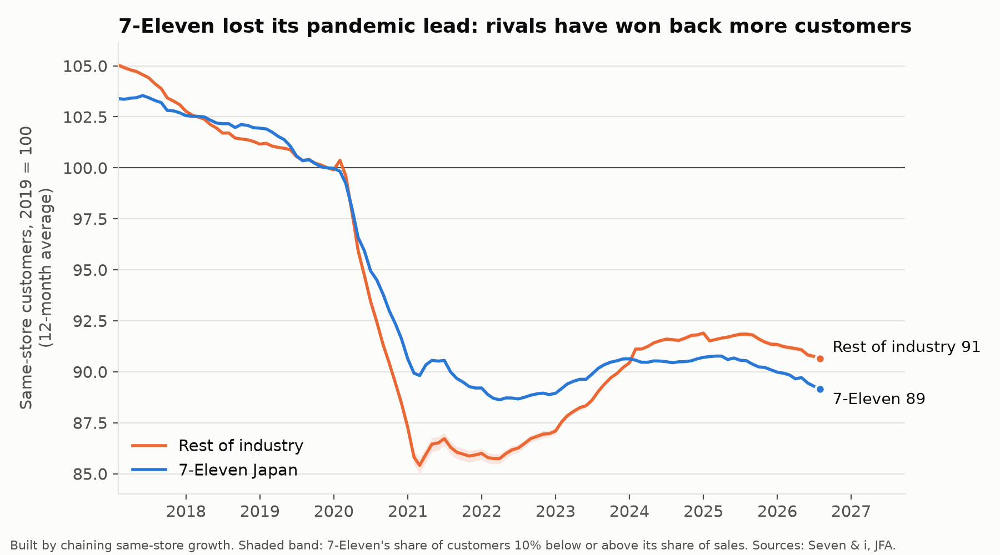
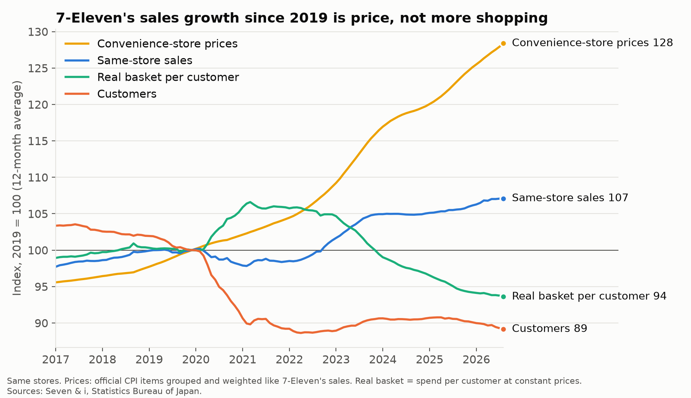
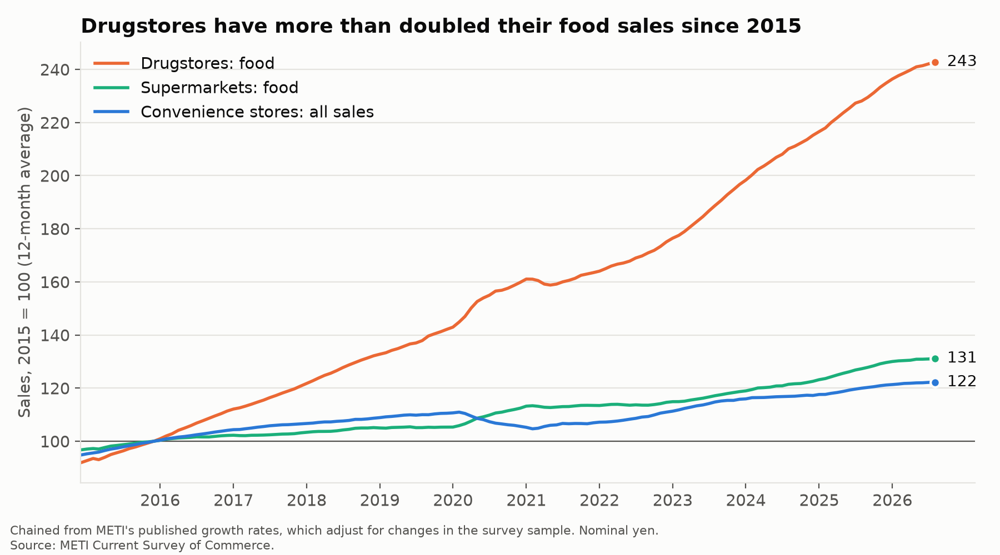
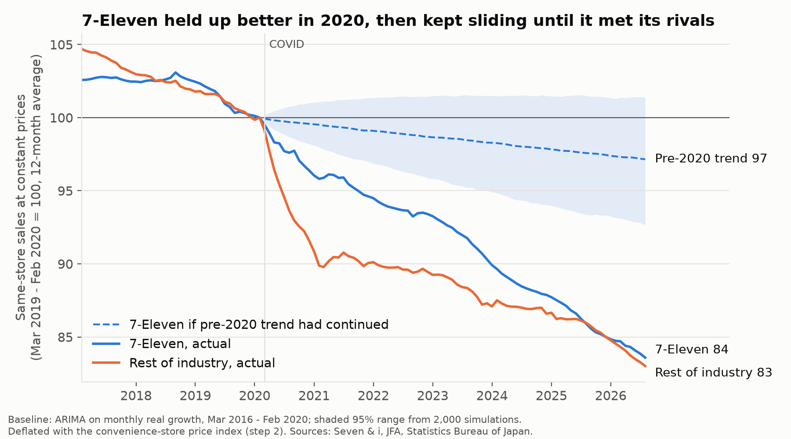

# 7-Eleven Japan: Who Pays?

**7-Eleven is often called the best-run convenience-store chain in the world. Where does its edge come from, who pays for it, and what is it worth?**

The project uses only public data: Seven & i's own filings, industry and government statistics, and OpenStreetMap. Each part uses a different method.

| Part | Question | Main skills | Status |
|---|---|---|---|
| 1. Location advantage | Does 7-Eleven's habit of clustering stores show in the map, and where are stores "missing"? | Spatial statistics, site-selection model | To do |
| 2. Where the customers went | Is 7-Eleven still growing once inflation is removed, and are drugstores taking its shoppers? | Time-series decomposition, panel regression, forecasting | **Done** |
| 3. Who pays | When wages and prices rise, does head office or the store owner absorb it? | Franchise unit economics, Monte Carlo | To do |
| 4. What it's worth | What is the market paying for the Japanese stores alone? | Sum-of-the-parts valuation | To do |

## Key findings so far (Part 2)

- **Sales growth since 2019 is all price.** Same-store sales are up 7%, but convenience-store prices are up 28%, more than twice the 13% rise in overall consumer prices. In real terms, 7-Eleven's stores sell about 16% less than before COVID: 11% fewer customers, each buying 6% less.
- **7-Eleven has lost its edge over its rivals.** Before 2020 it beat the rest of the industry on customer growth in 70% of months; since 2022, in 12%. It held up better in the 2020-21 slump, but rivals have since won back more customers.
- **Against its own pre-2020 path, 7-Eleven has lost about twice as much as its rivals.** Before COVID its real sales were almost flat (-0.4% a year) while rivals' were shrinking (-1.6% a year). Today both are about 16-17% below their 2019 level, so 7-Eleven is 14% below its own trend, against 8% for rivals.
- **Drugstores are the competitor people overlook.** Their food sales have grown 2.4 times since 2015, from about an eighth to a quarter of convenience-store sales. Regions where drugstores expanded fastest (Tohoku, Chubu) had the weakest convenience-store growth, and this holds when comparing regions in the same month.

---

## Part 2: Where the customers went

### 1. 7-Eleven vs. the rest of the industry

Industry figures from the Japan Franchise Association (JFA) include 7-Eleven, which is about 46% of industry sales, so a 7-Eleven-vs-industry comparison understates any gap. 7-Eleven is removed here. Its monthly sales in yen are rebuilt by chaining Seven & i's monthly growth figures and scaling each fiscal year to the yearly total in the Corporate Outline. The chained figures reproduce the published yearly growth to within 0.2 points. The rest of the industry's same-store growth is then (industry - w x 7-Eleven) / (1 - w), where w is 7-Eleven's share of sales a year earlier.

| Same-store customers, 2019 = 100 | 2021 | 2023 | 2024 | 2026 (Jan-Aug) |
|---|---|---|---|---|
| 7-Eleven | 89.2 | 90.6 | 90.6 | 88.8 |
| Rest of industry | 85.9 | 90.2 | 91.8 | 90.6 |

- **Growth vs. a year earlier exaggerates the story.** Rivals lost more customers in 2020-21, so part of their faster growth in 2022-24 is a rebound. A level index (2019 = 100) removes that effect, and the gap remains: 7-Eleven fell less, then was overtaken in 2024.
- 7-Eleven's share of customers isn't published, so its share of sales is used as the weight. Moving that weight 10% up or down barely changes the result (shaded band).

### 2. Price vs. what people actually buy

A convenience-store price index is built from official CPI items (bento, onigiri, sandwiches, fried chicken, bread, dairy, drinks, sweets, alcohol, cigarettes, everyday goods), grouped into 7-Eleven's four product groups and weighted by its sales mix from the previous year. Spend per customer is then split into price and "real basket" (spend at constant prices).

| Latest 12 months vs. 2019 | Change |
|---|---|
| Same-store sales | +7% |
| Customers | -11% |
| Convenience-store prices | +28% |
| Real basket per customer | -6% |
| *All consumer prices (for reference)* | *+13%* |

- **Customers fell in 2020 and never came back; then the basket started shrinking.** During COVID, fewer visits came with bigger baskets (+6% in 2020-21). From 2023, as prices rose 7% in a year, the real basket fell below its 2019 level and kept falling.
- **Fast food drove the price rise.** Its prices rose 8% in 2023 and 6% in 2025 (onigiri +46% since 2019).
- The split is not sensitive to the main assumption, cigarettes' share of non-food: using 50% or 100% instead of 75% moves the real basket by at most 1 point a year.

### 3. Are drugstores taking convenience-store shoppers?

- **Nationally:** drugstore food sales are 2.4 times their 2015 level, against 1.3 times for supermarket food and 1.2 times for convenience-store sales.
- **Region by month (8 regions, 116 months):** where drugstore numbers grew 1 point faster than usual, convenience-store sales grew 0.06 points slower (95% range -0.11 to -0.004). Month effects remove anything national (COVID, inflation, tax), and region effects remove fixed differences. Standard errors allow for correlation across regions and over time.
  - The effect is small month to month and weakens without 2020-21 (-0.07, p = 0.09).
  - Using drugstore *sales* instead of store numbers gives a positive, non-significant link. That is expected if drugstores and convenience stores both do well where local demand is strong, which is why store openings are the better measure.
  - Drugstores choose where to open, probably where demand is growing. That would push the estimate toward zero, so the negative effect is, if anything, understated.
- **Over ten years, by region:**

| Region | Drugstores, 2015 → now | Convenience-store sales, 2015 → now | Population 2020-24 |
|---|---|---|---|
| Hokkaido | +27% | +23% | -3.5% |
| Kyushu + Okinawa | +37% | +35% | -2.1% |
| Kanto | +45% | +22% | -0.7% |
| Chugoku | +61% | +20% | -3.5% |
| Shikoku | +62% | +17% | -4.4% |
| Kansai | +63% | +29% | -1.8% |
| Chubu | +80% | +12% | -2.1% |
| Tohoku | +86% | +10% | -4.7% |

  The correlation between the two growth columns is -0.73. Population decline explains part of it, but holding population change fixed, the link remains (-0.26 points per point, p = 0.08). With 8 regions, this is a description, not proof.

### 4. Compared with the pre-2020 path

An ARIMA model is fitted to 7-Eleven's monthly real sales growth from March 2016 to February 2020, then projected forward. 2,000 simulated paths give a 95% range. The same is done for the rest of the industry.

| Real same-store sales, latest 12 months | 7-Eleven | Rest of industry |
|---|---|---|
| Trend before 2020 | -0.4% a year | -1.6% a year |
| vs. Mar 2019 - Feb 2020 | -16.4% | -17.0% |
| vs. its own pre-2020 trend | **-14.0%** (range -17.8 to -10.1) | **-7.6%** (range -9.4 to -5.9) |

- The two ranges don't overlap: 7-Eleven has fallen further from its own path than its rivals have from theirs.
- 7-Eleven's pre-2020 advantage was holding volume steady while the rest of the industry shrank. That advantage is gone.
- This is a "what if trends had continued" baseline. It can't separate COVID, inflation and competition from each other.

---

## Data and method notes

Sources, download scripts and the traps found in the raw files are documented in [data/README.md](data/README.md). Scripts run in order from `src/`: `01*` download, `02*` clean, `03-06` are Part 2's analysis.

| Term | Definition |
|---|---|
| Same stores | Stores open in both this month and the same month last year |
| Fiscal year | Seven & i's runs March to February; FY2025 = March 2025 - February 2026 |
| Rest of industry | JFA member chains (FamilyMart, Lawson, Ministop, Daily Yamazaki, Seicomart, Poplar) minus 7-Eleven |
| Real basket | Spend per customer divided by the convenience-store price index |

## Limitations (Part 2)

- **7-Eleven's monthly figures are growth rates only.** Its monthly yen sales are rebuilt and scaled to yearly totals; the yearly totals use the pre-2022 accounting basis ("gross total store sales") throughout.
- **Customer weights are not published.** Rest-of-industry customer growth assumes 7-Eleven's share of customers equals its share of sales; a ±10% change moves results little.
- **Chained indexes drift.** Same-store sets change every year, so a long chain of same-store growth is approximate.
- **The price index is national CPI, not 7-Eleven's shelf prices.** 7-Eleven may have raised prices faster or slower than the average. CPI includes consumption tax; store sales are reported before tax (affects October 2019).
- **JFA membership changes over time**, so industry levels include chains joining and leaving; same-store growth is not affected.
- **7-Eleven's monthly figures exclude Okinawa** (a separate subsidiary, about 1% of stores).
- **METI's regional data groups Kyushu with Okinawa** for convenience stores; drugstore figures for the two are combined to match.
