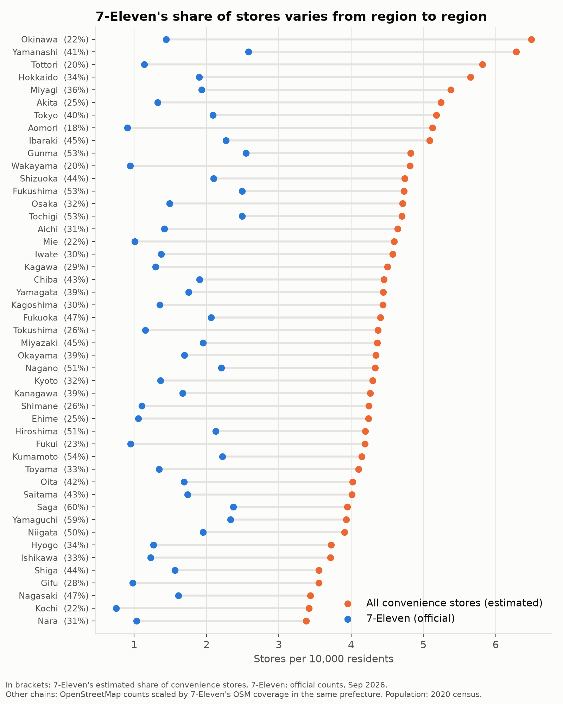
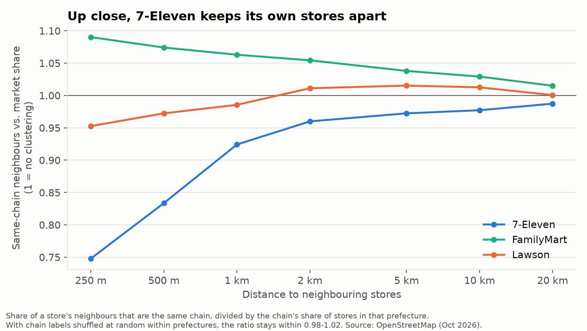
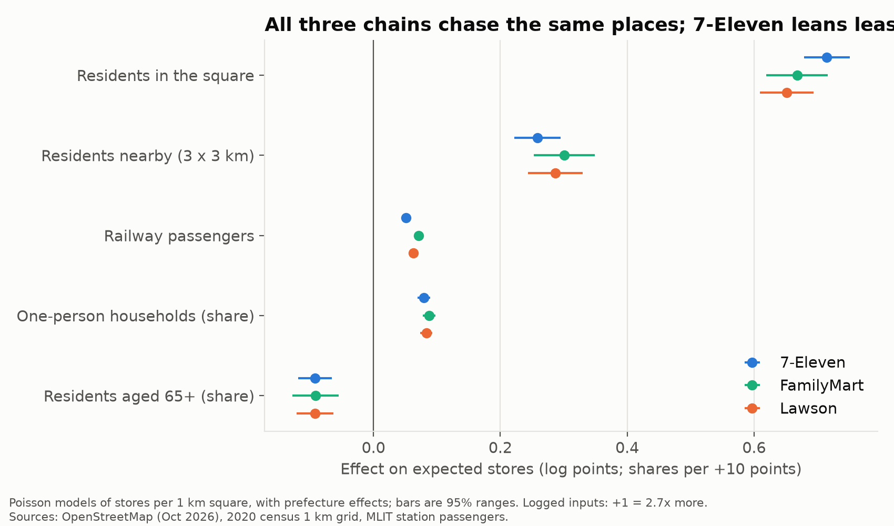
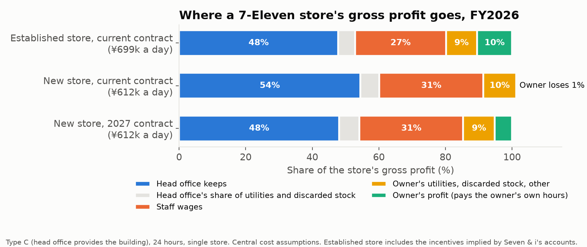
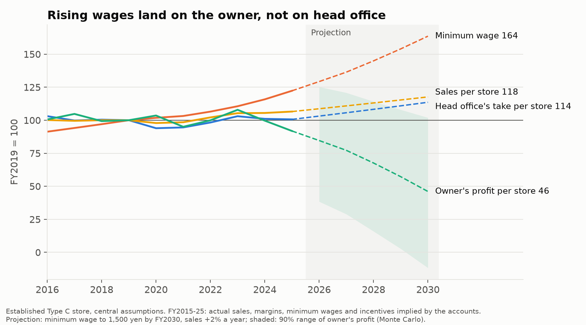
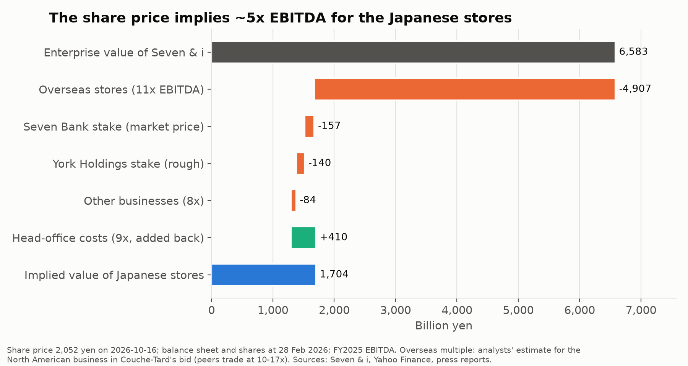
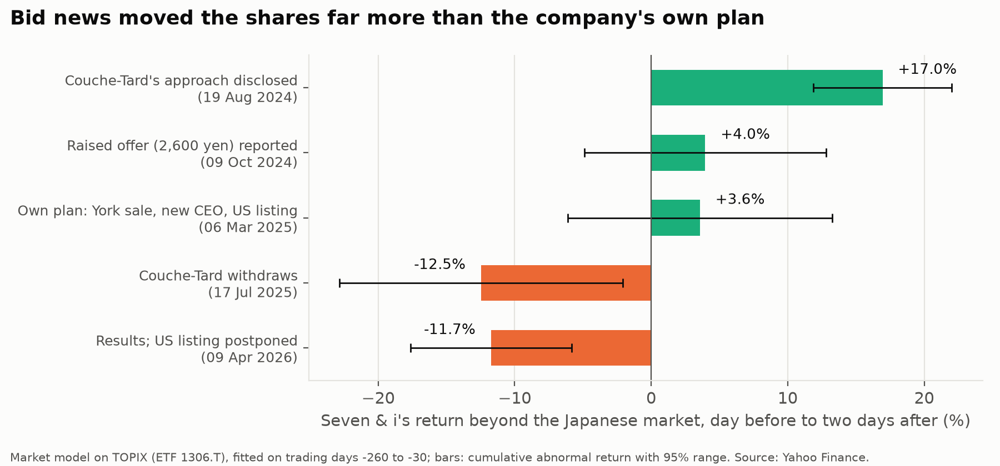

# 7-Eleven Japan: Who Pays?

**7-Eleven is often called the best-run convenience-store chain in the world. Where does its edge come from, who pays for it, and what is it worth?**

The project uses only public data: Seven & i's own filings, industry and government statistics, and OpenStreetMap. Each part uses a different method.

| Part | Question | Main skills | Status |
|---|---|---|---|
| 1. Where the stores are | Does 7-Eleven's habit of clustering stores show in the map, and where are stores "missing"? | Spatial statistics, permutation test, site-selection model | **Done** |
| 2. Where the customers went | Is 7-Eleven still growing once inflation is removed, and are drugstores taking its shoppers? | Time-series decomposition, panel regression, forecasting | **Done** |
| 3. Who pays | When wages and prices rise, does head office or the store owner absorb it? | Franchise unit economics, calibration to company accounts, Monte Carlo | **Done** |
| 4. What it's worth | What is the market paying for the Japanese stores alone? | Sum-of-the-parts valuation, event study | **Done** |

## The answer in one paragraph

7-Eleven's edge is real but narrower than its reputation. On the map, it dominates whole regions while keeping its own stores apart street by street (Part 1). Since 2019 its sales have grown only because prices rose; in real terms its stores sell about 16% less, and its lead over rivals in holding on to customers has gone (Part 2). The franchise model protects head office: its take per store has held steady, while rising wages have fallen on store owners, to the point where a typical new store no longer pays its owner a minimum wage under the current contract (Part 3). Investors seem to price exactly this: Seven & i's share price values the Japanese stores at roughly 5x EBITDA, far below what KDDI paid for Lawson, and the shares jumped on a takeover bid and fell when it, and later the US listing, went away (Part 4).

## Key findings

**Part 1: where the stores are**

- **7-Eleven's famous clustering doesn't show up at street level. If anything, the opposite.** Within 250 m of a 7-Eleven, other convenience stores are 7-Elevens only 0.75 times as often as its market share would predict; FamilyMart's ratio is 1.09. When chain labels are shuffled at random, 95% of results fall between 0.97 and 1.03. 7-Eleven keeps its own stores apart, and leaves the closest sites to rivals.
- **Its dominance is regional, not local.** 7-Eleven has 53-60% of convenience stores in its strongholds (Saga, Yamaguchi, Kumamoto, Tochigi, Gunma) and about 20% in the last prefectures it entered (Aomori, Kochi and Tottori in 2015, Okinawa in 2019).
- **All three big chains go to the same kind of place:** more residents, more one-person households, fewer elderly. A 10-point higher share of residents aged 65+ means about 9% fewer stores. 7-Eleven depends least on railway stations.
- **The model finds 153 "white-space" areas** where it expects at least two 7-Elevens, none is mapped, and rivals are trading. They are mostly in Aichi and Hyogo, where 7-Eleven's share is below average.

**Part 2: where the customers went**

- **Sales growth since 2019 is all price.** Same-store sales are up 7%, but convenience-store prices are up 28%, more than twice the 13% rise in overall consumer prices. In real terms, 7-Eleven's stores sell about 16% less than before COVID: 11% fewer customers, each buying 6% less.
- **7-Eleven has lost its edge over its rivals.** Before 2020 it beat the rest of the industry on customer growth in 70% of months; since 2022, in 12%. It held up better in the 2020-21 slump, but rivals have since won back more customers.
- **Against its own pre-2020 path, 7-Eleven has lost about twice as much as its rivals.** Before COVID its real sales were almost flat (-0.4% a year) while rivals' were shrinking (-1.6% a year). Today both are about 16-17% below their 2019 level, so 7-Eleven is 14% below its own trend, against 8% for rivals.
- **Drugstores are the competitor people overlook.** Their food sales have grown 2.4 times since 2015, from about an eighth to a quarter of convenience-store sales. Regions where drugstores expanded fastest (Tohoku, Chubu) had the weakest convenience-store growth, and this holds when comparing regions in the same month.

**Part 3: who pays**

- **Head office collects less than its published fee schedule says.** The schedule implies about 62% of an average store's gross profit; Seven & i's accounts imply 49% across the chain. The gap, undisclosed incentives, has grown from 5 to 9 points of gross profit since FY2015.
- **Even so, rising wages land on the owner.** From FY2019 to FY2025, a typical store's staff costs rose by about ¥318k a month. Head office's net take rose by ¥21k; the owner's profit fell by ¥72k. If the minimum wage reaches ¥1,500 by FY2030, an established owner's profit falls by about half from FY2019 while head office's take grows 14%.
- **Under the current contract, a typical new store no longer pays its owner a minimum wage.** At FY2026 wages it needs ¥730-910k of sales a day, against ¥612k for the average new store. Openings have fallen from 1,651 (FY2015) to 540 (FY2025).
- **The 2027 contract fixes that for new stores.** It leaves a typical new store's owner about ¥4.6M a year better off (better in every one of 2,000 simulations), even though owners take on more of the utilities.

**Part 4: what it's worth**

- **The share price values the Japanese stores at about 5x EBITDA** (¥1.7tn, 9x earnings), after subtracting the overseas business at the 11x analysts put on it during Couche-Tard's bid, the Seven Bank and York stakes, and other businesses. KDDI paid about 20x earnings for Lawson.
- **The answer swings with the overseas multiple:** from 8.7x if overseas is worth 9x, to 2.6x if it's worth 13x. Today's price can't support both businesses at peer-like multiples; that's the conglomerate discount in numbers.
- **At Couche-Tard's ¥2,600 offer, the Japanese stores would be valued at 9.5x EBITDA.** Valued like Lawson, they'd add about ¥900 per Seven & i share.
- **The shares rose 17% beyond the market when the bid emerged, and fell 12.5% when it was withdrawn.** Postponing the US listing (April 2026) cost almost as much (-11.7%), while the company's own restructuring plan barely moved the price (+3.6%, not significant).

---

## Part 1: Where the stores are

### Data

Store locations come from OpenStreetMap (48,973 convenience stores, October 2026). Each store is classified by chain from its name and brand tags; 353 entries belong to chains that no longer exist (Circle K Sunkus and others, converted to FamilyMart or Lawson by 2019) and are dropped as out of date. Stores, the 2020 census population on a 1 km grid (176,605 squares, 126.1 million people) and railway stations with daily passengers are placed in prefectures using the official boundary map.

**How complete is OpenStreetMap?** 7-Eleven publishes its store count by prefecture, which gives a direct test: OSM has 81% of 7-Eleven stores nationally, from 45% (Shimane) to 99% (Wakayama). Rival counts by prefecture are estimated by scaling their OSM counts by 7-Eleven's coverage in the same prefecture (pulled toward the national rate where 7-Eleven has few stores, since a new entrant is less well mapped). The estimates add up to within 3% of FamilyMart's and Lawson's official national totals.

- **7-Eleven has 38% of Japan's convenience stores**, but from 18% in Aomori to 60% in Saga. Its strongholds are northern Kanto (Tochigi, Gunma, Fukushima) and western Japan (Saga, Yamaguchi, Kumamoto); it is weakest in the last prefectures it entered: Aomori, Kochi and Tottori (2015) and Okinawa (2019).
- **Store density varies less than chain share.** Most prefectures have 4-5 convenience stores per 10,000 residents, whoever runs them.

### Does 7-Eleven cluster its stores?

7-Eleven is known for a "dominant area" strategy: opening many stores close together so delivery routes and advertising cover a dense patch. The test: for each store, what share of its neighbours within a given distance belong to the same chain, compared with that chain's share of stores in the prefecture? 1.0 means no more clustered than market share implies.

| Same-chain neighbours vs. market share | 250 m | 500 m | 1 km | 2 km | 20 km |
|---|---|---|---|---|---|
| 7-Eleven | **0.75** | **0.83** | 0.92 | 0.96 | 0.99 |
| FamilyMart | 1.09 | 1.07 | 1.06 | 1.05 | 1.02 |
| Lawson | 0.95 | 0.97 | 0.99 | 1.01 | 1.00 |
| *Random labels (200 shuffles within prefectures), 95% range* | | *0.97-1.03* | *0.98-1.02* | *0.98-1.02* | |

- **7-Eleven avoids itself at short range.** A 7-Eleven's nearest neighbours are rivals more often than its market share predicts. This isn't an artefact of 7-Eleven being stronger in suburbs: measured against its share of stores within 5 km of each store, the 250 m ratio is still 0.77.
- **Lawson is within the random range** from 500 m to 2 km (0.97-1.01): no clustering either way.
- **FamilyMart is the one that clusters,** probably a legacy of its mergers: Circle K Sunkus and am/pm stores were converted where those chains had dense networks.
- **So "dominance" works at the scale of a region, not a street.** A plausible reading is that 7-Eleven spaces stores to limit cannibalisation between franchise owners, while still saturating whole regions (see the shares above). The data can't show intent.

### What predicts a convenience store, and where is 7-Eleven missing?

A Poisson model predicts the number of stores in each 1 km square from: residents in the square, residents in the 8 squares around it, share aged 65+, share of one-person households, railway passengers, and a prefecture effect (which also absorbs differences in map coverage). It is fitted for all chains together and for each of the big three.

| Effect on expected stores | All chains | 7-Eleven | FamilyMart | Lawson |
|---|---|---|---|---|
| 2.7x more residents in the square | +0.69 log points | +0.72 | +0.67 | +0.65 |
| 2.7x more residents nearby | +0.25 | +0.26 | +0.30 | +0.29 |
| 2.7x more railway passengers | +0.06 | **+0.05** | +0.07 | +0.06 |
| +10 points one-person households | +8% | +8% | +9% | +9% |
| +10 points aged 65+ | -9% | -9% | -9% | -9% |

- **The three chains look for the same things.** The only clear difference: 7-Eleven depends less on railway stations than FamilyMart (95% ranges don't overlap) and slightly more on residents.
- **Ageing is a headwind for everyone.** Areas with more elderly residents have fewer stores, even with the same population. Japan's population is ageing fastest outside the big cities.
- **Validation:** fitted without prefecture effects on four-fifths of prefectures, the model explains 69% of the variation (deviance) in store counts in the held-out fifth. At the level of 3 x 3 km blocks, predicted and actual store counts correlate at 0.42, so it captures broad demand, not exact sites.

**White space.** Blocks of 3 x 3 km where the model expects at least two 7-Elevens, none is mapped, and at least three rival stores are (so the area is mapped and has demand): 153 blocks, most in Aichi (17) and Hyogo (13). The largest are around Ayaragi (Shimonoseki, Yamaguchi), Kuki (Saitama), Kongo and Sayama (south Osaka) and Nomachi (Kanazawa). With OSM missing about a fifth of stores, each is a lead to check on a map, not a confirmed gap. The full list is in [data/processed/part1_white_space.csv](data/processed/part1_white_space.csv).

---

## Part 2: Where the customers went

### 1. 7-Eleven vs. the rest of the industry

Industry figures from the Japan Franchise Association (JFA) include 7-Eleven, which is about 46% of industry sales, so a 7-Eleven-vs-industry comparison understates any gap. 7-Eleven is removed here. Its monthly sales in yen are rebuilt by chaining Seven & i's monthly growth figures and scaling each fiscal year to the yearly total in the Corporate Outline. The chained figures reproduce the published yearly growth to within 0.2 points. The rest of the industry's same-store growth is then (industry - w x 7-Eleven) / (1 - w), where w is 7-Eleven's share of sales a year earlier.

| Same-store customers, 2019 = 100 | 2021 | 2023 | 2024 | 2026 (Jan-Aug) |
|---|---|---|---|---|
| 7-Eleven | 89.2 | 90.6 | 90.6 | 88.8 |
| Rest of industry | 85.9 | 90.2 | 91.8 | 90.6 |

- **Growth vs. a year earlier exaggerates the story.** Rivals lost more customers in 2020-21, so part of their faster growth in 2022-24 is a rebound. A level index (2019 = 100) removes that effect, and the gap remains: 7-Eleven fell less, then was overtaken in 2024.
- 7-Eleven's share of customers isn't published, so its share of sales is used as the weight. Moving that weight 10% up or down barely changes the result (shaded band).

### 2. Price vs. what people actually buy

A convenience-store price index is built from official CPI items (bento, onigiri, sandwiches, fried chicken, bread, dairy, drinks, sweets, alcohol, cigarettes, everyday goods), grouped into 7-Eleven's four product groups and weighted by its sales mix from the previous year. Spend per customer is then split into price and "real basket" (spend at constant prices).

| Latest 12 months vs. 2019 | Change |
|---|---|
| Same-store sales | +7% |
| Customers | -11% |
| Convenience-store prices | +28% |
| Real basket per customer | -6% |
| *All consumer prices (for reference)* | *+13%* |

- **Customers fell in 2020 and never came back; then the basket started shrinking.** During COVID, fewer visits came with bigger baskets (+6% in 2020-21). From 2023, as prices rose 7% in a year, the real basket fell below its 2019 level and kept falling.
- **Fast food drove the price rise.** Its prices rose 8% in 2023 and 6% in 2025 (onigiri +46% since 2019).
- The split is not sensitive to the main assumption, cigarettes' share of non-food: using 50% or 100% instead of 75% moves the real basket by at most 1 point a year.

### 3. Are drugstores taking convenience-store shoppers?

- **Nationally:** drugstore food sales are 2.4 times their 2015 level, against 1.3 times for supermarket food and 1.2 times for convenience-store sales.
- **Region by month (8 regions, 116 months):** where drugstore numbers grew 1 point faster than usual, convenience-store sales grew 0.06 points slower (95% range -0.11 to -0.004). Month effects remove anything national (COVID, inflation, tax), and region effects remove fixed differences. Standard errors allow for correlation across regions and over time.
  - The effect is small month to month and weakens without 2020-21 (-0.07, p = 0.09).
  - Using drugstore *sales* instead of store numbers gives a positive, non-significant link. That is expected if drugstores and convenience stores both do well where local demand is strong, which is why store openings are the better measure.
  - Drugstores choose where to open, probably where demand is growing. That would push the estimate toward zero, so the negative effect is, if anything, understated.
- **Over ten years, by region:**

| Region | Drugstores, 2015 → now | Convenience-store sales, 2015 → now | Population 2020-24 |
|---|---|---|---|
| Hokkaido | +27% | +23% | -3.5% |
| Kyushu + Okinawa | +37% | +35% | -2.1% |
| Kanto | +45% | +22% | -0.7% |
| Chugoku | +61% | +20% | -3.5% |
| Shikoku | +62% | +17% | -4.4% |
| Kansai | +63% | +29% | -1.8% |
| Chubu | +80% | +12% | -2.1% |
| Tohoku | +86% | +10% | -4.7% |

  The correlation between the two growth columns is -0.73. Population decline explains part of it, but holding population change fixed, the link remains (-0.26 points per point, p = 0.08). With 8 regions, this is a description, not proof.

### 4. Compared with the pre-2020 path

An ARIMA model is fitted to 7-Eleven's monthly real sales growth from March 2016 to February 2020, then projected forward. 2,000 simulated paths give a 95% range. The same is done for the rest of the industry.

| Real same-store sales, latest 12 months | 7-Eleven | Rest of industry |
|---|---|---|
| Trend before 2020 | -0.4% a year | -1.6% a year |
| vs. Mar 2019 - Feb 2020 | -16.4% | -17.0% |
| vs. its own pre-2020 trend | **-13.9%** (range -17.6 to -10.2) | **-7.6%** (range -9.2 to -5.8) |

- The two ranges don't overlap: 7-Eleven has fallen further from its own path than its rivals have from theirs.
- 7-Eleven's pre-2020 advantage was holding volume steady while the rest of the industry shrank. That advantage is gone.
- This is a "what if trends had continued" baseline. It can't separate COVID, inflation and competition from each other.

---

## Part 3: Who pays

### The contract

Owners of Type C stores (17,329 of 21,564 franchised stores) run the shop; head office provides the building and equipment. Head office takes a share of each store's monthly gross profit on a sliding scale, from 56% on the first ¥2.5M up to 76% on profit above ¥5.5M, minus reductions for 24-hour stores. Two details matter:

- **The charge is calculated before discarded stock is deducted.** Seven & i's own definition of gross profit leaves out "inventory loss, disposal of unsold items". So owners pay the charge on food they throw away, and then bear 85% of its cost. Japan's Supreme Court reviewed this method in 2007.
- **Head office pays 80% of utilities and 15% of discarded stock,** and tops up the owner's gross profit to ¥20M a year if a store falls short.

The new contract announced in June 2026 (new stores only, from about autumn 2027) has two tiers, 53% and 67%. In return, owners pay 50% of utilities instead of 20%, and head office pays 50% of discarded stock instead of 15%.

### The model

A monthly profit-and-loss for a 24-hour Type C store ([src/franchise_model.py](src/franchise_model.py)): gross profit, minus the charge, staff wages, the owner's share of utilities and discarded stock, and other costs. What's left is the owner's profit, which pays for the owner's and family's own long hours. Sales, margins and contract terms are Seven & i's figures; minimum wages are official, by prefecture. Staffing and costs aren't published, so each has a low, central and high value ([data/manual/store_cost_assumptions.csv](data/manual/store_cost_assumptions.csv)), and every result is also run 2,000 times with those inputs drawn at random.

**Calibration.** Head office's revenue, minus sales at its 158 company-run stores, is roughly what owners pay in charges. Divided by franchise stores' gross profit, that gives the charge actually collected:

| | FY2015 | FY2019 | FY2022 | FY2025 |
|---|---|---|---|---|
| Charge implied by Seven & i's accounts | 51.1% | 50.6% | 49.7% | 48.9% |
| Published Type C schedule, average store | 60.9% | 61.1% | 61.3% | 61.8% |
| Gap: undisclosed incentives (Type A and C) | 5.0 pts | 6.2 pts | 7.5 pts | 8.9 pts |

The model applies that gap to established stores. New stores don't get the "5-year incentive", so they are modelled on the published schedule.

**Check against a leaked internal simulation.** Diamond reported in October 2025 that 7-Eleven's own simulation shows owner profit falling to about a third if the minimum wage reaches ¥1,500 with sales unchanged. The model gives 0.14 at its central values, with a middle-90% range of -0.87 to 0.51 across draws: the leaked figure sits inside it, and the model is if anything more pessimistic.

### Where the gross profit goes

| FY2026, per store per year (central values) | Established store, current contract | New store, current contract | New store, 2027 contract |
|---|---|---|---|
| Sales per day | ¥699k | ¥612k | ¥612k |
| Owner's profit | ¥8.5M | ¥-0.9M | ¥3.7M |
| Owner's profit, 90% range (Monte Carlo) | ¥3.6M to ¥12.8M | ¥-5.0M to ¥2.7M | ¥-0.2M to ¥7.4M |
| Owner's profit per own hour (10 h a day) | ¥2,333 | loss | ¥1,010 |
| Head office's share of one extra yen of gross profit | 64% | 73% | 67% |

- **Price rises are shared; wage rises are not.** When prices lift gross profit, head office takes 64-73% of every extra yen. When wages rise, the owner pays 100%.
- **The 2027 contract is a better deal for a new store.** Lower charge rates more than make up for paying 50% of utilities. The owner comes out ahead in all 2,000 simulations, by about ¥4.6M a year (median).

### Who absorbed the last six years, and the next five

| Established store, FY2019 = 100 | FY2022 | FY2025 | FY2030 (projection) |
|---|---|---|---|
| Minimum wage | 107 | 122 | 164 |
| Sales per store | 102 | 107 | 118 |
| Head office's take per store | 98 | 101 | 114 |
| Owner's profit per store | 100 | 92 | 46 |

- **FY2019-FY2025:** staff costs per store rose about ¥318k a month. Head office's take barely moved (+¥21k) because it gave back more in incentives; the owner's profit fell ¥72k (-8%). Press reports of franchise profit falling 4.3% in FY2024 and again in FY2025 point the same way.
- **To FY2030:** with the minimum wage reaching ¥1,500 and sales growing 2% a year, an established owner's profit halves from its FY2019 level (90% range: from roughly flat to a loss), unless incentives grow further.

### How much a store needs to sell

The daily sales at which the owner earns at least the local minimum wage for their own hours, FY2026:

| | Lowest-wage prefectures (Miyazaki, Kochi, Okinawa) | Osaka | Tokyo, Kanagawa |
|---|---|---|---|
| Established store, current contract | ¥518k | ¥612k | ¥644k |
| New store, current contract | ¥726k | ¥864k | ¥909k |
| New store, 2027 contract | ¥563k | ¥663k | ¥695k |
| *Average new store's actual sales (FY2025)* | *¥612k* | *¥612k* | *¥612k* |

Under the current contract, a typical new store falls short everywhere. Under the 2027 contract, it clears the bar in low-wage prefectures but still not in the big cities, where wages are highest. That fits what the company has been doing: openings fell from 1,651 in FY2015 to 540 in FY2025.

---

## Part 4: What it's worth

Seven & i is now mostly two businesses: the Japanese stores and the overseas stores (7-Eleven Inc. in North America, and Australia). It sold the supermarkets (York Holdings) to Bain Capital in September 2025, keeping a minority stake, and cut its Seven Bank holding to about 40% in June 2025. Only the group has a share price, so the value of the Japanese stores has to be backed out.

### Sum of the parts

Seven & i's share price, times its 2.315bn shares, plus net debt and minority interests, gives what the market pays for the whole group. Subtracting everything else that can be valued leaves the Japanese stores. The balance sheet and share count are both at 28 February 2026 (the 2025 buyback was complete by then), so they match. Leases are off balance sheet and inside EBITDA for both businesses, so the multiples are like for like.

| Billion yen (share price ¥2,052, 16 Oct 2026) | |
|---|---|
| Market value of shares | 4,751 |
| + Net debt (debt 2,230 - cash 426) and minority interests | 1,832 |
| **= Enterprise value of Seven & i** | **6,583** |
| - Overseas stores: FY2025 EBITDA 446 x 11 | -4,907 |
| - Seven Bank stake (40% of its market value) | -157 |
| - York Holdings stake (rough: ~35% of post-deal equity) | -140 |
| - Other businesses (EBITDA 10.5 x 8) | -84 |
| + Head-office costs (EBITDA -45.5 x 9) | +410 |
| **= Implied value of the Japanese stores** | **1,704** |
| Japanese stores' FY2025 EBITDA / 7-Eleven Japan's net income | 314 / 191 |
| **Implied multiples** | **5.4x EBITDA, 8.9x earnings** |

**Why 11x for overseas?** Analysts put Couche-Tard's first offer at about 11x EBITDA for the North American business, the top of its usual deal range. US peers trade at 10.2x (Murphy USA) to 17.4x (Casey's, a fast-growing outlier); Couche-Tard itself trades at 13.6x on an IFRS basis that flatters the ratio.

| Implied EV/EBITDA of the Japanese stores | Head-office costs at 6x | 9x | 12x |
|---|---|---|---|
| Overseas at 9x | 7.8 | 8.3 | 8.7 |
| Overseas at 10x | 6.4 | 6.8 | 7.3 |
| **Overseas at 11x** | 5.0 | **5.4** | 5.9 |
| Overseas at 12x | 3.6 | 4.0 | 4.4 |
| Overseas at 13x | 2.1 | 2.6 | 3.0 |

- **The Japanese stores look cheap at any plausible overseas multiple.** Even at 9x for overseas, Japan comes out at about 8x EBITDA. Japan's largest convenience-store chain, with Japan's highest sales per store, is being valued below the price KDDI paid for its smaller rival (about 20x earnings for Lawson, against 9x here).
- **One reading:** investors doubt the Japanese profit is as solid as it looks. That fits Parts 2 and 3: real sales per store are falling, and the franchise model is reaching the limit of what owners can absorb.
- **At other prices:** at Couche-Tard's ¥2,600 per share, on today's balance sheet, the Japanese stores would be worth ¥2.97tn (9.5x EBITDA, 15.6x earnings). Valued like Lawson, they would be worth ¥3.8tn, about ¥900 per Seven & i share more than the market implies.

### How the shares reacted

A market model compares Seven & i's daily return with the Japanese market's (TOPIX), using the year before each event. The abnormal return is the part the market doesn't explain, added up from the day before to two days after.

| Event | Abnormal return | 95% range |
|---|---|---|
| Couche-Tard's approach disclosed (19 Aug 2024) | **+17.0%** | +11.9% to +22.0% |
| Raised offer reported (9 Oct 2024) | +4.0% | -4.9% to +12.8% |
| Own plan: York sale, new CEO, US listing (6 Mar 2025) | +3.6% | -6.1% to +13.3% |
| Couche-Tard withdraws (17 Jul 2025) | **-12.5%** | -22.8% to -2.1% |
| Results; US listing postponed (9 Apr 2026) | **-11.7%** | -17.6% to -5.8% |

- **The bid put about 17% on the share price; its withdrawal took about 12.5% back.**
- **The company's own plan didn't convince the market** (+3.6%, inside the range of normal noise), while postponing the US listing cost almost as much as losing the bidder. Investors seem to have valued the listing as the next-best way to show what the overseas business is worth separately.

---

## Data and method notes

Sources, download scripts and the traps found in the raw files are documented in [data/README.md](data/README.md). Scripts run in order from `src/`: `01*` download, `02*` clean, then the analysis: `03-05` Part 1, `06-09` Part 2, `10` Part 3 (store model in `franchise_model.py`), `11-12` Part 4.

| Term | Definition |
|---|---|
| Same stores | Stores open in both this month and the same month last year |
| Fiscal year | Seven & i's runs March to February; FY2025 = March 2025 - February 2026 |
| Rest of industry | JFA member chains (FamilyMart, Lawson, Ministop, Daily Yamazaki, Seicomart, Poplar) minus 7-Eleven |
| Real basket | Spend per customer divided by the convenience-store price index |

## Limitations (Part 1)

- **OpenStreetMap is incomplete and partly out of date.** It has about 81% of 7-Eleven's stores, unevenly by prefecture; rivals' coverage is assumed similar within a prefecture (checked only against national totals). Random gaps make clustering estimates noisier but not biased; gaps concentrated in particular areas could bias the site model and create false "white space".
- **The census grid is from 2020**; stores are from 2026.
- **Station passengers are by operator**, so a station served by several companies counts each operator's passengers.
- **Simplified prefecture boundaries** (Global Map Japan) put 74 seaside stores just offshore; they are given the nearest prefecture.
- **The site model describes where stores are, not where they would be profitable.** Rival presence is not an input, so "white space" means demand without a 7-Eleven, which could also mean a site 7-Eleven tried and left.

## Limitations (Part 2)

- **7-Eleven's monthly figures are growth rates only.** Its monthly yen sales are rebuilt and scaled to yearly totals; the yearly totals use the pre-2022 accounting basis ("gross total store sales") throughout.
- **Customer weights are not published.** Rest-of-industry customer growth assumes 7-Eleven's share of customers equals its share of sales; a ±10% change moves results little.
- **Chained indexes drift.** Same-store sets change every year, so a long chain of same-store growth is approximate.
- **The price index is national CPI, not 7-Eleven's shelf prices.** 7-Eleven may have raised prices faster or slower than the average. CPI includes consumption tax; store sales are reported before tax (affects October 2019).
- **JFA membership changes over time**, so industry levels include chains joining and leaving; same-store growth is not affected.
- **7-Eleven's monthly figures exclude Okinawa** (a separate subsidiary, about 1% of stores).
- **METI's regional data groups Kyushu with Okinawa** for convenience stores; drugstore figures for the two are combined to match.
## Limitations (Part 3)

- **Store costs are assumptions.** Staffing, pay above the minimum, utilities, discarded stock and other costs aren't published; results are shown across their plausible ranges, but the ranges themselves are judgement.
- **The undisclosed incentives are inferred**, assuming head office's revenue (minus company-run store sales) is all franchise charges and that Type A and C stores get the same incentive share. Other operating revenue would make the true incentive smaller.
- **One typical store, not the distribution.** Real stores differ in sales, staffing and hours; the tiered charge means a chain average isn't the average store's outcome.
- **The 2027 contract's minimum guarantee and the cap on head office's share of discarded stock aren't published**; the guarantee is assumed unchanged and the cap not binding.
- **Type A stores** (owner provides the building, 45% charge) are not modelled; they also bear property costs.
- **Prefecture break-evens use national average sales and costs**; only wages vary by prefecture.

## Limitations (Part 4)

- **The result depends most on the overseas multiple**, which is a judgement (sensitivity table above). The York Holdings stake has no market price and is a rough estimate (±¥70bn moves Japan by about ±0.2x).
- **Mixed dates:** the share price is from October 2026; the balance sheet, share count and EBITDA are from FY2025 (ended February 2026). Buybacks since February and FY2026 trading are not reflected.
- **Lawson's deal multiple is on IFRS earnings and includes Lawson Bank**, so the comparison is indicative.
- **Event dates are when news became public**; some was leaked or expected earlier, which would shrink the measured reactions. Daily prices can't separate news released on the same day.
